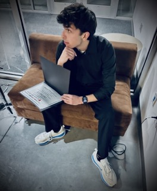

# About Me
I am an undergrad student in mechanical engineering at the University of New Mexico currently working as a facilities engineer @ Intel. My interests lie in applying numerical analysis & ML towards traditional engineering design challenges. I enjoy student activities and I am an officer of the UNM Materials Research Society Student Chapter.
